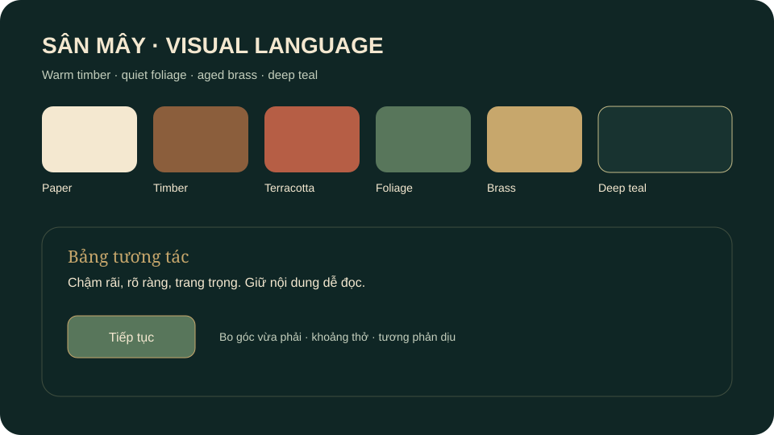

# C1 sample board

The SVG below is a design reference rendered from the shared palette; it is not a screenshot of the game. Browser capture is pending.

| Sample | Before | After |
|---|---|---|
| Shared color/spacing tokens | No central token file in baseline stylesheet | `public/css/tokens.css` supplies named palette, spacing, shape, elevation, motion and layer values |
| HUD/panel surfaces | Independent literal values | HUD actions and panels consume shared surface, border, radius, shadow and blur tokens |
| Running-game screenshot | NOT RUN | NOT RUN |

Capture same-scene screenshots at equal camera, lighting, viewport and quality before claiming visual improvement.
